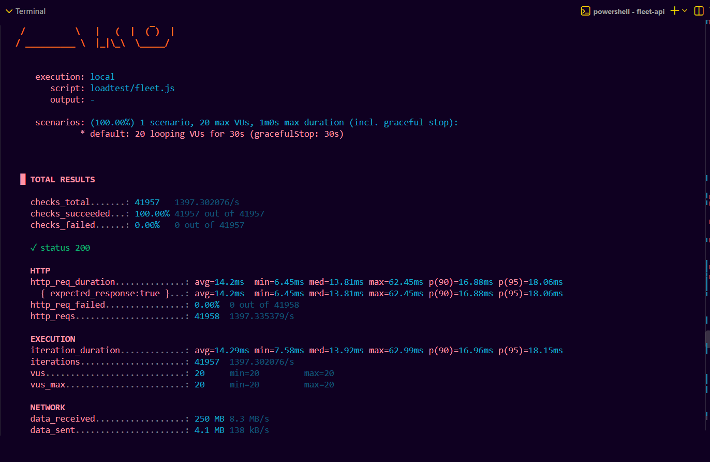
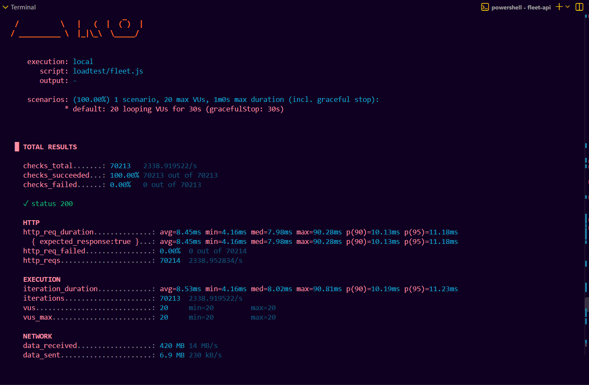
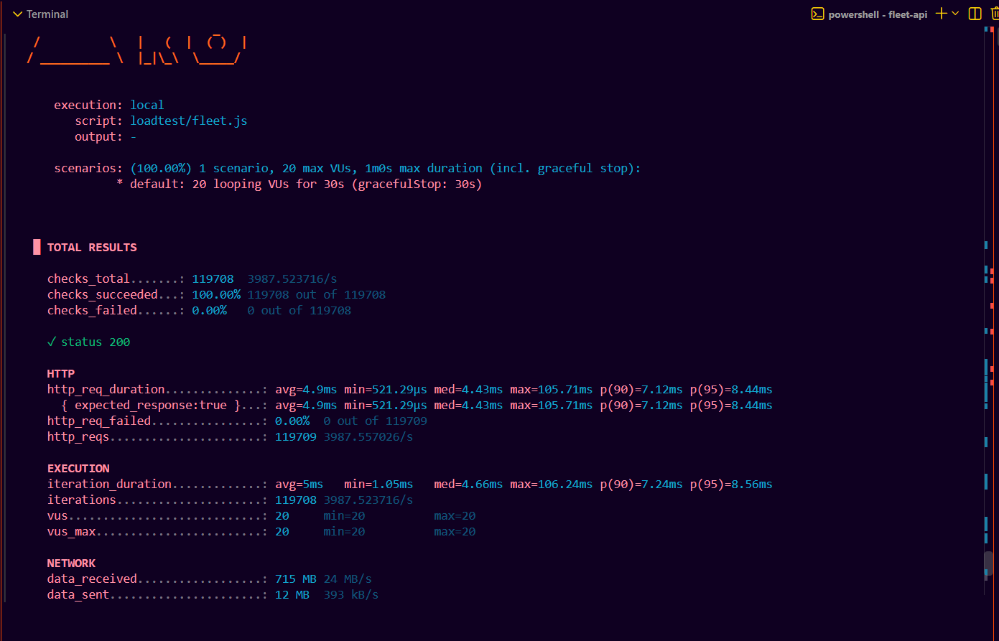

# fleet-api

Express API for the fleet operations console database (`db/01-schema.sql` + `db/02-seed.sql`, unchanged).
Postgres holds the data, Redis does caching and shared rate limits, and nginx fronts several API instances.

- [Quick start](#quick-start)
- [Endpoints](#endpoints)
- [See the benchmark stats, step by step](#see-the-benchmark-stats-step-by-step)
- [Example results](#example-results)
- [Troubleshooting](#troubleshooting)
- [What this benchmark does not show](#what-this-benchmark-does-not-show)
- [How it uses your schema](#how-it-uses-your-schema)

## Quick start

You need Docker. Everything else runs in containers.

```bash
docker compose up --build
```

The first start loads `db/` in order: `00-bootstrap.sql` (local stand-ins for Supabase's roles and `auth` schema),
your schema, your seed, then `03-api-role.sql`. To reload from scratch: `docker compose down -v`.

In a second terminal, check that it works:

```bash
curl http://127.0.0.1:8080/health          # expect {"ok":true,"redis":true}
./scripts/smoke.sh http://127.0.0.1:8080   # bash only: checks every endpoint
```

On Windows PowerShell, `curl` is an alias for something else. Use `curl.exe` instead.
If port 8080 is already used by another program, see [Troubleshooting](#troubleshooting).

## Endpoints

| Method | Path | Notes |
|---|---|---|
| GET | `/health` | database + Redis status |
| GET | `/api/vehicles?depot=&limit=&cursor=` | map list, status derived on read, cursor pagination |
| GET | `/api/vehicles/:id` | vehicle + 5 latest trips + unresolved alerts |
| GET | `/api/vehicles/:id/trips?limit=&before=` | trip summaries, newest first |
| GET | `/api/trips/:id/points?every=` | GPS breadcrumbs; `every=5` returns each 5th point |
| GET | `/api/alerts?state=&vehicle=&limit=&before=` | `state`: unresolved (default), open, acknowledged, resolved, all |
| PATCH | `/api/alerts/:id` | `{"action":"acknowledge"\|"resolve"}`, calls `set_alert_state()` |

PATCH identifies the operator with an `X-Operator-Id` header (a UUID that exists in `auth.users`); without it the
seeded demo operator is used. **That header is a placeholder, not authentication.** Do not expose this API to the
internet before adding real auth.

## See the benchmark stats, step by step

The goal: three load-test runs, one per setup, each giving requests/sec, latency and error rate.

| Run | Setup | Settings |
|---|---|---|
| 1 | no cache, 1 API instance | `CACHE_ENABLED=false`, `API_REPLICAS=1` |
| 2 | Redis cache, 1 API instance | `CACHE_ENABLED=true`, `API_REPLICAS=1` |
| 3 | Redis cache, 3 API instances behind nginx | `CACHE_ENABLED=true`, `API_REPLICAS=3` |

### Step 0: install k6 (free)

- Windows: `winget install k6 --source winget`, then **open a new terminal**.
  (If `k6` is still not found in the same window, run
  `$env:Path = [System.Environment]::GetEnvironmentVariable("Path","Machine") + ";" + [System.Environment]::GetEnvironmentVariable("Path","User")`.)
- macOS: `brew install k6`
- Linux and other options: see the official k6 install guide.

Check it with `k6 version`.

### Step 1: set the settings for run 1

The rate limit must be raised, or the limiter answers `429` and you measure the limiter instead of the API.

PowerShell:
```powershell
$env:RATE_LIMIT_PER_MIN="1000000"
$env:CACHE_ENABLED="false"
$env:API_REPLICAS="1"
docker compose up -d --build
```

bash / zsh:
```bash
export RATE_LIMIT_PER_MIN=1000000 CACHE_ENABLED=false API_REPLICAS=1
docker compose up -d --build
```

`$env:` and `export` only last for the current terminal window. Set all three again in a new window.

### Step 2: confirm the setup before measuring

```powershell
curl.exe -s -o NUL -w "%{http_code}`n" http://127.0.0.1:8080/api/vehicles
```
(bash: `curl -s -o /dev/null -w '%{http_code}\n' http://127.0.0.1:8080/api/vehicles`)

Expect `200`. With the cache **off**, no `X-Cache` header is sent. With the cache **on**, send the request twice
within 5 seconds and expect `MISS` then `HIT`:

```powershell
1..2 | % { curl.exe -s -D - -o NUL http://127.0.0.1:8080/api/vehicles | Select-String "x-cache" }
```
(bash: `for i in 1 2; do curl -s -D - -o /dev/null http://127.0.0.1:8080/api/vehicles | grep -i x-cache; done`)

### Step 3: run the load test

```bash
k6 run -e BASE_URL=http://127.0.0.1:8080 loadtest/fleet.js
```

It sends 20 virtual users for 30 seconds: 50% fleet list, 30% unresolved alerts, 20% vehicle detail. Use `127.0.0.1`
and not `localhost`, so every run goes to the same address.

### Step 4: read the numbers

At the end, k6 prints a summary. Copy these lines:

| What you want | Line in the k6 output | Value to copy |
|---|---|---|
| Requests/sec | `http_reqs` | the rate after the total, for example `1397.335379/s` |
| Total requests | `http_reqs` | the number, for example `41958` |
| Average / median / p95 / max latency | `http_req_duration` | `avg=`, `med=`, `p(95)=`, `max=` |
| Error rate | `http_req_failed` | the percentage, **must be `0.00%`** |
| All responses were 200 | `checks_succeeded` | **must be `100.00%`** |

If `http_req_failed` is not `0.00%`, do not use that run. See [Troubleshooting](#troubleshooting).

### Step 5: repeat for runs 2 and 3

Run 2 (cache on):
```powershell
$env:CACHE_ENABLED="true"
docker compose up -d
```
Check `MISS` then `HIT` (step 2), then run k6 again.

Run 3 (cache on, 3 instances):
```powershell
$env:API_REPLICAS="3"
docker compose up -d
docker compose restart nginx
docker compose ps
```
`docker compose ps` must list `fleet-api-api-1`, `-2` and `-3`. Restarting nginx makes it pick up the new containers.
Then check `MISS` then `HIT` again and run k6.

Optional proof that all three instances take traffic: in a second terminal, run `docker stats` while k6 is running.
CPU should be above zero on all three `fleet-api-api-*` containers.

### Step 6: make the numbers trustworthy

- Run each setup **3 times** and keep the middle result. Without repeats, say "single run" next to your table.
- Same machine, same script, same `VUS` and `DURATION` for every run. Close heavy apps first.
- Write your setup under the table (machine, CPU cores, "k6 and the whole stack on one laptop").
- Do not change the script between runs. The script has no `sleep()` on purpose: a pause would cap every setup
  at about the same requests/sec and hide the differences.

### Step 7: screenshot the proof

For each run, crop the k6 summary from `TOTAL RESULTS` down to `http_reqs`. Also useful: the `X-Cache` MISS/HIT lines
and the `docker compose ps` output with three API containers. Label each image with its setup.

## Example results

One run per row, 20 virtual users, 30 seconds, k6 and the whole stack on a single laptop. Your numbers will differ.

| Setup | Total requests | Requests/sec | Avg | Median | p95 | Max | Error rate |
|---|---|---|---|---|---|---|---|
| No cache, 1 API instance | 41,958 | 1,397 | 14.2 ms | 13.8 ms | 18.1 ms | 62.5 ms | 0.00% |
| + Redis cache, 1 API instance | 70,214 | 2,339 | 8.5 ms | 8.0 ms | 11.2 ms | 90.3 ms | 0.00% |
| + Redis cache, 3 API instances behind nginx | 119,709 | 3,988 | 4.9 ms | 4.4 ms | 8.4 ms | 105.7 ms | 0.00% |





Cached responses can be up to 5 seconds old (`CACHE_TTL_S`). The seed data is small (14 vehicles, 56 trips, about
6,000 GPS points), so these runs compare caching and instance count only. They say nothing about indexes or pagination.

## Troubleshooting

| Symptom | Cause and fix |
|---|---|
| `k6` is not recognized | The terminal started before the install. Open a new terminal, or refresh the PATH (step 0). |
| PowerShell asks about "script execution risk" | `curl` is an alias for `Invoke-WebRequest`. Use `curl.exe`. |
| k6 fails in setup with an **HTML 404 page** | Another program is using port 8080. Find it with `Get-NetTCPConnection -LocalPort 8080 -State Listen`, then run the stack on another port: `$env:NGINX_PORT="8081"`, `docker compose up -d`, and use `http://127.0.0.1:8081` everywhere. |
| `http_req_failed` above 0% or many `429` | The rate limit is still low. Set `RATE_LIMIT_PER_MIN=1000000` and run `docker compose up -d` again. |
| No `X-Cache` header | Normal when `CACHE_ENABLED=false`. |
| `X-Cache: MISS` twice | The two requests were more than 5 seconds apart. Send them back to back. |
| Run 3 shows only one API container | Set `API_REPLICAS=3` in this same terminal, run `docker compose up -d`, then `docker compose restart nginx`. |
| `502` right after starting | The API is still starting. Wait a few seconds. |
| Vehicles show as `offline` | The seed's timestamps are relative to when it ran. Re-anchor: `docker compose exec db psql -U postgres -d fleet -c "select public.shift_seed_to_now()"` |
| `docker compose up` ignores a changed setting | Variables are per terminal window. Set them again in the window you run Compose from. |

## What this benchmark does not show

A load test measures how fast the API answers one fixed workload. It does not prove production readiness.

- **Database overload:** total connections = API instances x `PG_POOL_MAX` (default 10). Postgres allows about 100 by
  default, so scaling out can exhaust it.
- **Cache failures:** with Redis down the API keeps answering from Postgres (tested functionally), but not tested under load.
- **Traffic spikes:** the test is a flat 20 users. A ramping test would show spike behaviour.
- **Memory leaks:** 30 seconds cannot show degradation over hours. Run a longer soak test.
- **Security:** `X-Operator-Id` is not authentication, and load testing proves nothing about security.
- **Single points of failure:** three API containers on one machine do not survive that machine failing. Postgres,
  Redis and nginx are single instances too.

## How it uses your schema

- The API logs in as `fleet_api`, a role that is only a member of `authenticated`. It can do exactly what your grants
  allow: read the six tables and run `set_alert_state()`. It cannot read `driver_contacts` or write any table.
- Alert writes go through `set_alert_state()`; the API sets `request.jwt.claim.sub` so `auth.uid()` works the way it does on Supabase.
- Vehicle status is derived in `src/status.js` (moving, idle, parked, offline). **These rules are an assumption**; replace them with your own.
- Local development without the API container: `docker compose up db redis`, then `cp .env.example .env`, `npm install`, `npm run dev`.
- On a real Supabase project, run `db/01-schema.sql` then `db/02-seed.sql` in the SQL editor (skip `00-bootstrap` and
  `03-api-role`), and point `DATABASE_URL` at a role that is a member of `authenticated`.

## Environment variables

| Variable | Default | Meaning |
|---|---|---|
| `NGINX_PORT` | `8080` | host port for nginx |
| `API_REPLICAS` | `1` | number of API containers |
| `CACHE_ENABLED` | `true` | Redis response cache on/off |
| `CACHE_TTL_S` | `5` | cache lifetime in seconds |
| `RATE_LIMIT_ENABLED` | `true` | rate limiter on/off |
| `RATE_LIMIT_PER_MIN` | `600` | requests per minute per client |
| `PG_POOL_MAX` | `10` | database connections per API instance |
| `STALE_AFTER_S` | `120` | seconds without a ping before a running vehicle is `offline` |
